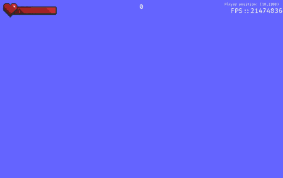
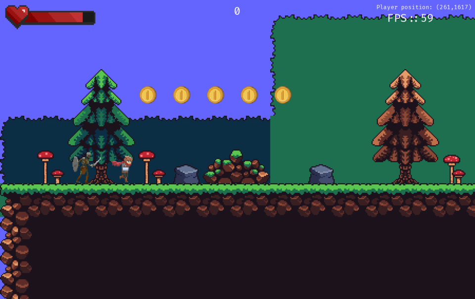
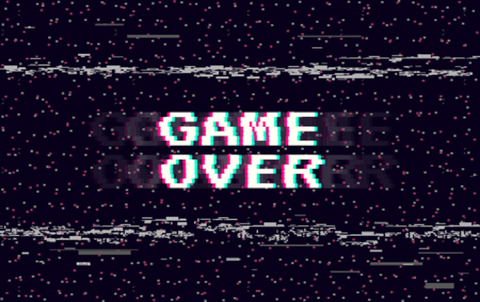
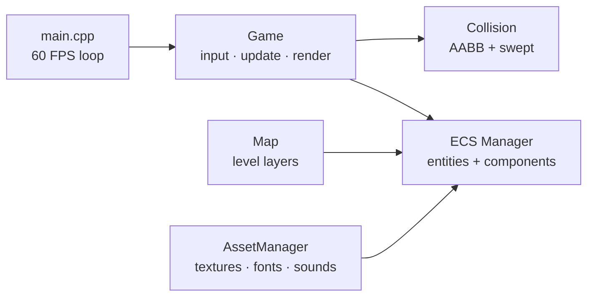

# DungeonRush

A simple 2D platformer made in C++ and SDL2, built on **Apollo**, a small 2D
game engine I wrote alongside it. Run through the forest, collect coins, fight
the skeleton and reach the end of the level before your health runs out.

<p align="center">
  
</p>

| Gameplay | Game over |
|---|---|
|  |  |

## Features

- **Hand-written ECS** (`src/ECS/ECS.h`): entities, components looked up by a
  compile-time type ID, and up to 32 render groups
- **Tile maps**: a 150 × 30 level built from CSV layers (background,
  foreground, decor, colliders, coins), drawn at 3× scale
- **Swept AABB collision**: a ray-vs-rectangle test resolves the player and
  enemies against the level, so fast movement doesn't tunnel through walls
- **Gravity** with a terminal velocity, plus jumping
- **Sprite-sheet animation**: idle, run, jump and three attack animations
- **Skeleton enemy**: chases the player when close, attacks on contact, takes
  hits, plays a death animation and is removed
- **Coins and score**: animated coins add 10 points, with a sound
- **HUD**: health bar, score, player position and FPS
- **End state**: reaching the end of the level, or running out of health,
  shows a game-over screen and switches the music
- **Camera** that follows the player, clamped to the level

## Controls

| Key | Action |
|---|---|
| `A` / `D` | Move left / right |
| `W` | Jump |
| `Q`, `E`, `F` | Three different sword attacks |
| `Esc` | Quit |

## Architecture

`main.cpp` runs the game loop at 60 FPS. Each frame, `Game` reads input,
updates the world and draws it. Every object in the game (player, enemy,
tiles, coins, HUD) is an entity in the ECS, made up of components.



| Part | Files | What it does |
|---|---|---|
| Game loop | `src/main.cpp` | Creates the game and runs it at a fixed 60 FPS |
| Game | `src/Game.cpp` | Loads assets and the level, creates the player, enemy and HUD, handles input, updates and draws everything |
| ECS | `src/ECS/ECS.h` | `Entity`, `Component` and `Manager`; groups entities by what they are (tiles, players, enemies, coins, labels) |
| Components | `src/ECS/*.h` | Transform, rigid body (gravity), sprite and animation, collider, tile, script (enemy AI), projectile, UI label |
| Collision | `src/Collision.cpp` | Overlap tests and swept ray-vs-rectangle collision |
| Level | `src/Map.cpp` | Reads the `.map` layers and creates tile, collider and coin entities |
| Assets | `src/AssetManager.cpp`, `src/TextureManager.cpp` | Loads and stores textures, fonts and sounds by name |

## Directory structure

```text
.
├── CMakeLists.txt          # CMake build
├── build.sh                # build and run script
├── assets/
│   ├── fonts/              # Arial, Fira Code
│   ├── sounds/             # music, jump, coin, game-over
│   ├── sprites/            # player, skeleton, health bar, game-over screen
│   └── tileset/            # tileset image + .map level layers
├── src/
│   ├── main.cpp            # game loop
│   ├── Game.cpp/.h         # game setup, update, render
│   ├── Map.cpp/.h          # level loader
│   ├── Collision.cpp/.h    # collision tests
│   ├── AssetManager.*      # textures, fonts, sounds
│   ├── TextureManager.*    # image loading and drawing
│   ├── Vector2D.*          # 2D math
│   └── ECS/                # entity-component system + components
└── docs/                   # screenshots
```

## Build and run

### Prerequisites

- A C++14 compiler
- CMake 3.16 or newer and `pkg-config`
- SDL2, SDL2_image, SDL2_ttf, SDL2_mixer

Ubuntu / Debian:

```bash
sudo apt install build-essential cmake pkg-config libsdl2-dev libsdl2-image-dev libsdl2-ttf-dev libsdl2-mixer-dev
```

macOS (Homebrew):

```bash
brew install cmake pkg-config sdl2 sdl2_image sdl2_ttf sdl2_mixer
```

### Clone, build, run

```bash
git clone https://github.com/SauravBastola/DungeonRush2.git
cd DungeonRush2
./build.sh run
```

The binary is built to `bin/Prelude`. It loads assets from `../assets`, so
always start it from inside `bin/`:

```bash
cd bin && ./Prelude
```

### Commands

| Command | What it does |
|---|---|
| `./build.sh` | Build `bin/Prelude` |
| `./build.sh run` | Build, then start the game |
| `./build.sh clean` | Delete the build output |

## License

Code is under the [MIT License](LICENSE). The art, fonts and sounds in
`assets/` are from third-party sources and not covered by it.
