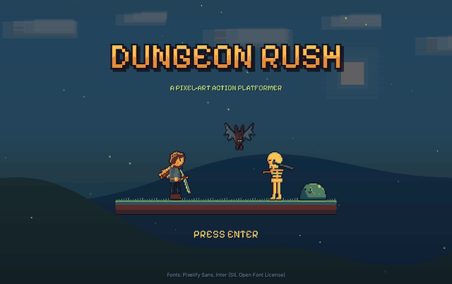
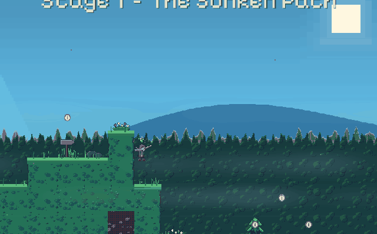
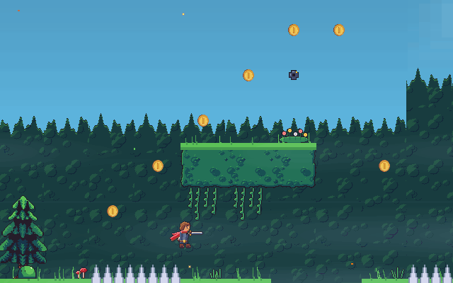
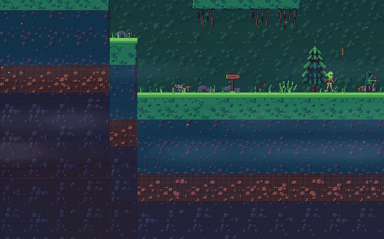
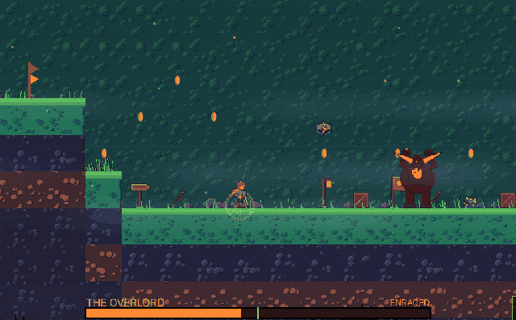
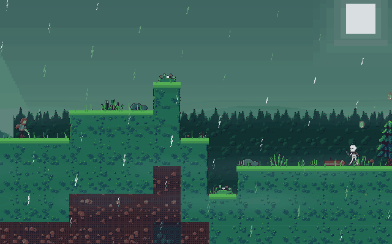
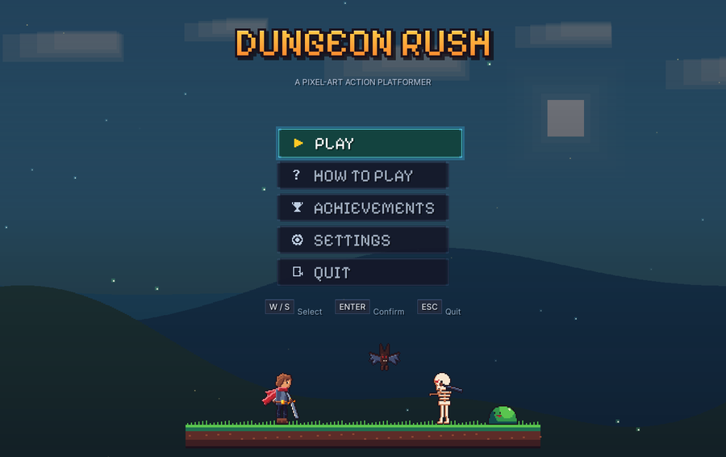
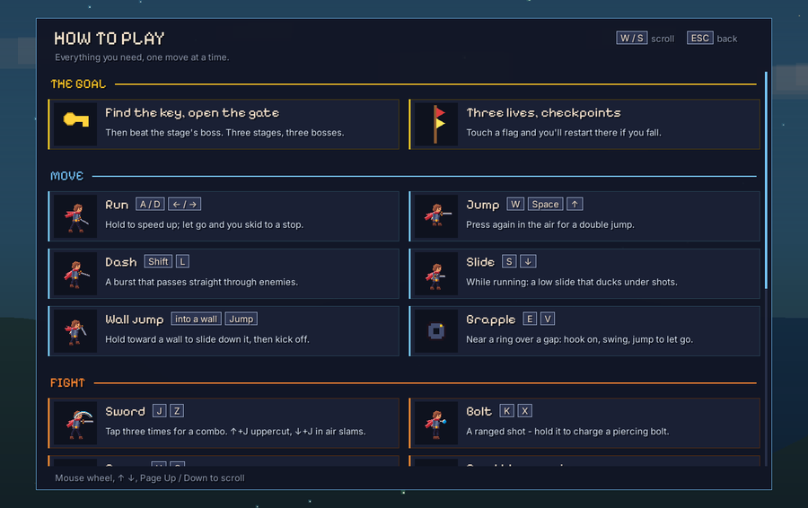
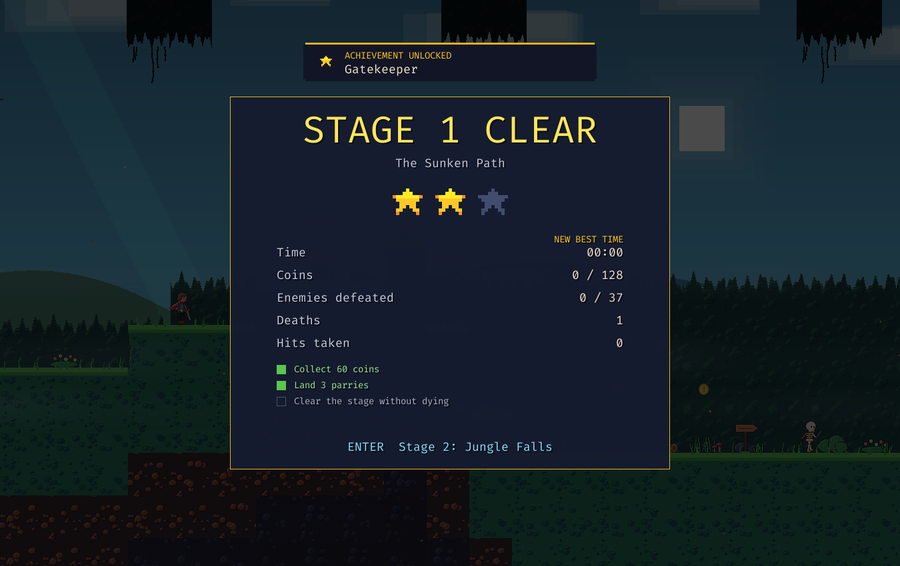
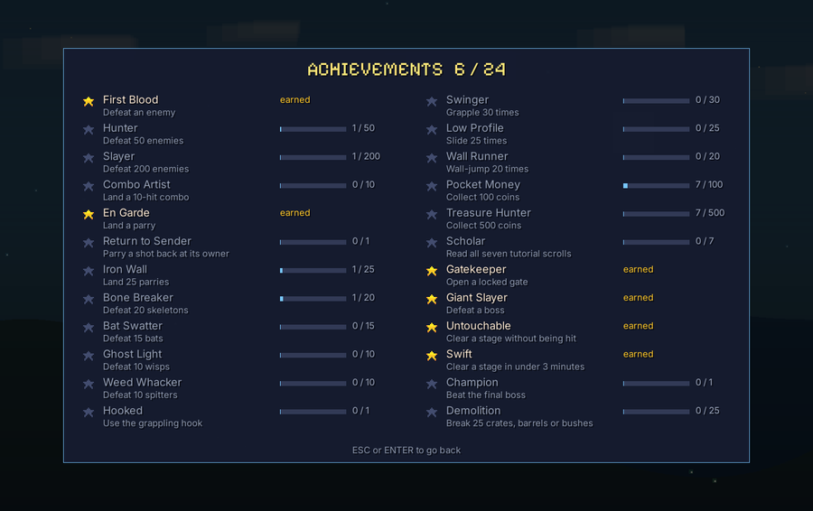

# DungeonRush

**A pixel-art action platformer in C++17 and SDL2.** Run, slide and grapple
through three hand-tuned stages, read your enemies' tells, parry their attacks
back at them, and take down a boss at the end of each stage.



| | |
|:-:|:-:|
|  |  |
| *Run, jump, double-jump and dash* | *Grapple across gaps and swing out of pits* |
|  |  |
| *Combos, parries and readable enemy tells* | *Bosses roar at half health and unleash a signature attack* |



---

## The game

You cross three stages, each ending in a locked gate and a boss arena:

| Stage | Look and feel | Boss |
|---|---|---|
| **The Sunken Path** | Meadows, ruins and a flooded hollow | **The Overlord**: rockfall |
| **Jungle Falls** | Misty, rain-soaked cliffs and water chasms | **The Thorn King**: spore rain |
| **Ember Canyon** | Dusk-lit canyon, drifting ash and embers | **The Ember Titan**: rolling lava waves |

Find the key, open the gate, defeat the boss. Score and lives carry from stage
to stage; checkpoint flags save your place. Clearing a stage unlocks it from
the menu's **Continue**.

### Moves

- **Run, jump, double-jump and dash** (the dash passes straight through enemies)
- **Slide** under shots while running
- **Wall-slide and wall-jump** on any tall wall
- **Grappling hook**: rings hang over every gap; hook on, swing, fling off
- **Sword combo** (three hits), **uppercut** and **air slam**
- **Bolts**: tap for a quick shot, hold for a piercing one
- **Parry**: block just as a hit lands to send arrows back at their archer and stagger melee attackers

### Enemies

Nine enemy types plus three bosses. Every attack is **telegraphed**: a skeleton
raises its sword and its eye flares, a bat hovers before it dives, a spitter
swells before it lobs a seed, a wisp flares before it lunges, and boss attacks
are marked on the ground before they land. Each warning is both visible and
audible.

### Progress

- **Stage results** with time, coins, kills and a **1–3 star** rating
- **Three tasks per stage**, shown on the pause screen
- **24 achievements** across combat, movement, exploration and mastery
- Best times and stars are saved per stage

| | |
|:-:|:-:|
|  |  |
|  |  |

### Presentation

- 1:1 pixel art throughout: generated tilesets, props, hero and enemy sheets
  with smooth animation loops and transitions (run-start, skid, turn,
  wall-slide, fall)
- Layered parallax, light shafts, fog, weather (rain, ash) and ambient life
- Props that react: grass rustles, bushes and crates break (sometimes with coins
  inside), lanterns swing
- Generated sound effects for every action and every enemy warning, plus a
  per-stage ambient soundscape
- Smart on-screen hints that introduce moves as you need them, plus tutorial
  signposts; turn them off with **Tab**
- Resizable window, borderless fullscreen, Retina support, sharp or fill pixel
  scaling

---

## Controls

| Action | Keys |
|---|---|
| Move | **A / D** or **← / →** |
| Jump (press again in the air to double-jump) | **W**, **Space** or **↑** |
| Dash | **Shift** or **L** |
| Slide (while running) | **S** or **↓** |
| Sword (tap ×3 for a combo; **↑+J** uppercut, **↓+J** air slam) | **J** or **Z** |
| Bolt (hold to charge) | **K** or **X** |
| Parry | **U** or **C** |
| Grapple (near a ring) | **E** or **V** |
| Hints on / off | **Tab** or **F1** |
| Pause (tasks, settings, run stats) | **P** or **Esc** |
| Settings / Help / Mute | **O** / **H** / **M** |
| Fullscreen | **F11** or **Alt/⌘ + Enter** |

---

## Building and running

The game needs a C++17 compiler, CMake 3.16+, pkg-config, and SDL2 with
SDL2_image, SDL2_ttf and SDL2_mixer.

**macOS (Homebrew)**

```sh
brew install cmake pkg-config sdl2 sdl2_image sdl2_ttf sdl2_mixer
./build.sh
./bin/DungeonRush
```

**Linux (Debian / Ubuntu)**

```sh
sudo apt install build-essential cmake pkg-config \
    libsdl2-dev libsdl2-image-dev libsdl2-ttf-dev libsdl2-mixer-dev
./build.sh
./bin/DungeonRush
```

`build.sh` configures a Release build in `cmake-build-debug/` and places the
binary in `bin/`. Settings and best scores are saved to `dungeonrush.save`;
achievements, tasks and stage bests to `dungeonrush.progress` (both in the
working directory, both ignored by git).

---

## Project layout

```
src/
  main.cpp, Game.*          game loop, states, menus, HUD, progression
  ECS/                      entity-component system: transforms, sprites,
                            colliders, health, AI, projectiles, platforms
  Systems/                  physics, combat, enemy AI, particles, parallax,
                            atmosphere, ambient life, scenery
  Level.h                   generated stage data (terrain, enemies, coins, hooks)
  Config.h                  every tuning constant in one place
  SpriteSpec.h              sprite sheet geometry and colliders
assets/
  tileset/                  terrain, props and per-stage map layers
  sprites/                  hero, enemies, effects
  sounds/sfx/, music/       generated effects and ambience; music slots
  fonts/                    Pixelify Sans, Inter (+ licences)
tools/                      content generators (see below)
```

### Content pipeline

The art, levels and sound are produced by small, deterministic Python scripts
in `tools/`. The same script always produces byte-identical output, so assets
stay reproducible and easy to tweak:

| Script | Produces |
|---|---|
| `build_terrain.py` | the autotiled terrain tileset (materials, depth bands) |
| `build_props.py` | the props sheet (plants, crates, lanterns, pines …) |
| `build_art.py` | hero and enemy sprite sheets, boss effects (PNG + SVG) |
| `build_level.py` | all three stages' maps, colliders and `src/Level.h` |
| `build_sfx.py` | every sound effect and ambient loop |

`build_level.py` validates every stage as it builds it. It checks every jump
and gap against the movement budget, keeps enemies away from spawns,
checkpoints and chasm edges, keeps grapple rings reachable and moving platforms
on their routes, and refuses to finish if any prop floats.

```sh
python3 tools/build_level.py     # regenerate the stages
python3 tools/build_sfx.py       # regenerate the sound effects
```

### Music

Drop tracks into `assets/sounds/music/` named `stage1`, `stage2`, `stage3`
and `boss` (`.ogg`, `.mp3` or `.wav`). Missing ones fall back to the default
track. See `assets/sounds/music/README.md`.

---

## Credits and licences

- **Fonts:** [Pixelify Sans](https://fonts.google.com/specimen/Pixelify+Sans)
  and [Inter](https://fonts.google.com/specimen/Inter), both under the SIL Open
  Font License (texts in `assets/fonts/`).
- **Art and sound effects** are generated by the scripts in `tools/`.
